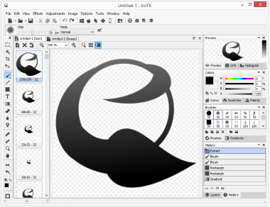
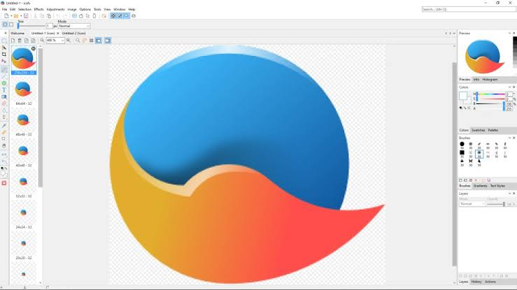
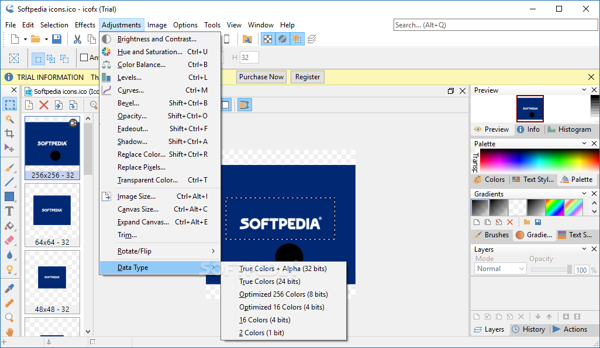

# IcoFX Icons and Cursors for Application Delivery

An icon delivery usually contains several images for the same symbol, while a cursor also needs an accurate click position.
IcoFX Icon Editor brings drawing, format conversion, resource extraction, and cursor editing into one Windows application.

[](https://icofx-icon-editor.github.io/IcoFX-ICO-Editor/)

## Choose the deliverable before drawing

Decide where the asset will appear and what information its container must preserve.
Keep an editable master alongside the files supplied to an application or website.

| Deliverable | Format | Information to preserve | Final inspection |
|---|---|---|---|
| Windows application icon | ICO | Required image sizes and transparency | Inspect every embedded size |
| macOS icon | ICNS | Appropriate platform representations | Preview in the target application |
| Static pointer | CUR | Artwork and hot spot | Test the actual click position |
| Animated pointer | ANI | Frames, timing, and hot spot | Play the complete sequence |
| Editable artwork | IFX | Layers for further editing | Reopen and inspect layer structure |
| Website image | PNG or ICO | Intended dimensions and transparent edges | Preview against the page background |

IcoFX ICO Editor can hold multiple image representations in a single icon.
Exporting one selected image to PNG produces a different deliverable from saving the complete ICO container.

The supplied [Pinta.ico](xdg/Pinta.ico) is an example of an application icon asset.
The accompanying [pinta.svg](snap/gui/pinta.svg) provides a vector artwork reference for comparison.

## Judge the symbol at its smallest useful size

Start with a recognisable silhouette and a limited amount of internal detail.
Thin gaps, small lettering, and soft shadows often need adjustment when artwork is reduced.

Review the smallest representation before spending time on decorative effects:

- Check whether the main shape remains identifiable.
- Separate adjacent features that merge into a dark patch.
- Compare the apparent weight of horizontal and diagonal strokes.
- Inspect the transparent edge on both light and dark backgrounds.

IcoFX provides pixel-oriented drawing tools, zoom, and a grid for detailed corrections.
Use those controls to refine individual representations rather than assuming that one reduction suits every size.



Keep a layered IFX master for revisions.
PNG export flattens the image, so retain the master when shadows, outlines, or overlays may change later.

## Assemble the size variants deliberately

Create the representations required by the destination application.
Keep the subject aligned consistently so that switching between sizes does not appear to move the symbol.

For Windows icons, the Windows Icon From Image dialog provides a dedicated conversion workflow.
Review the generated representations individually, especially where a small version needs simplified artwork.

When a build process already produces separate PNG variants, a short Node.js step can package those images:

```javascript
const fs = require('node:fs');
const toIco = require('to-ico');

async function packageIcon() {
  const sizes = [16, 32, 48, 256];
  const images = sizes.map(size => fs.readFileSync('app-' + size + '.png'));
  fs.writeFileSync('application.ico', await toIco(images));
}
packageIcon().catch(error => { console.error(error); process.exitCode = 1; });
```

Use square PNG inputs with 8-bit RGB or RGBA channels and the dimensions named in the script.
The to-ico package must be available in the Node.js environment.

Open the resulting ICO in IcoFX and inspect its image list.
Check that the intended sizes survived packaging and that transparent borders remain clean.

## Give cursors a functional click position

IcoFX cursor editor workflows add a hot spot to the visual design.
For an arrow, the visible tip and the active click coordinate should agree.

Use the Cursor Hot Spot dialog to set or inspect the X and Y coordinates.
Test the pointer against small controls, text boundaries, and narrow window edges.

Animated cursors also require a review of the sequence:

1. Keep the subject stable across frames.
2. Check frame timing at normal playback speed.
3. Verify that the hot spot stays aligned with the intended action.
4. Save as ANI when the animation must remain a cursor.



An exported still image does not preserve the behaviour of an animated pointer.
Keep the CUR or ANI deliverable available for functional testing.

## Review icons in their application context

A correct image file can still look wrong when its launcher, background, or display scale changes.
Test the delivered asset where the user will actually encounter it.

The Pinta desktop integration samples show how an application points to its icon:

- [com.github.PintaProject.Pinta.desktop.in](xdg/com.github.PintaProject.Pinta.desktop.in) declares the desktop launcher and icon identifier.
- [pinta.desktop](snap/gui/pinta.desktop) uses an icon path within its package.
- [com.github.PintaProject.Pinta.metainfo.xml.in](xdg/com.github.PintaProject.Pinta.metainfo.xml.in) describes the application for desktop software metadata.

For executable resources, IcoFX can extract icons and edit icon libraries.
Record which resource and image representation you intend to replace before making changes to a working copy.
Keep the original binary separately so that the replacement can be compared with its source.



Use [license-mit.txt](license-mit.txt) to review the licence supplied with the companion materials.
Confirm permission separately for any artwork taken from another application.

## Repeat conversion with a recorded recipe

For a collection of assets, settle the output sizes and naming convention before processing the full folder.
The IcoFX icon converter workflow supports batch operations; scripting availability depends on the licence edition.

The documented IcoFX Script Editor is available with Business/Site licensing.
This FXS recipe converts PNG artwork to ICO with an explicit list of representations:

```text
create
  "artwork\*.png"
  -type ico
  -formats 16x16-32, 32x32-32, 48x48-32, 256x256-32
  -output "export"
```

Save the recipe as make-icons.fxs and prepare the input and output folders.
Launch it from PowerShell with the script and executable in the working directory:

```powershell
$icofxExecutable = ".\icofx3.exe"
& $icofxExecutable ".\make-icons.fxs"
```

IcoFX accepts a script file as a command-line argument.
When multiple script arguments are supplied, its documentation states that only the first is executed.

Keep the conversion recipe with the editable master and the exported files.
For companion environment context, [pinta.1](xdg/pinta.1) documents opening files in Pinta, while [snapcraft.yaml](snap/snapcraft.yaml) records its Snap packaging configuration.

## Check meaning across language settings

An icon should remain understandable when the nearby label changes language or length.
Avoid embedding essential words into a small bitmap when the interface can provide a translated label.

The supplied translation materials offer concrete examples for reviewing image-editor terminology:

- [en_GB.po](po/en_GB.po): English (United Kingdom).
- [de.po](po/de.po): German.
- [fr.po](po/fr.po): French.
- [es.po](po/es.po): Spanish.
- [ru.po](po/ru.po): Russian.
- [ja.po](po/ja.po): Japanese.
- [zh_CN.po](po/zh_CN.po): Simplified Chinese.
- [ar.po](po/ar.po): Arabic.

Compare the intended action with the label beside the icon, particularly for commands such as export, extract, and convert.
For a right-to-left interface, review directional symbols in their actual layout before deciding whether mirroring is appropriate.

[POTFILES.in](po/POTFILES.in) lists source locations used for translation extraction.
[Makevars](po/Makevars) defines extraction options, and [messages.in](po/messages.in) supplies an additional translatable message.

## Keep revisions distinguishable

Before delivery, reopen the saved file and check its actual contents.
Do not rely only on the working canvas or the filename extension.

Record the changes that affect the consuming application:

- Image dimensions added or removed.
- Transparency or palette changes.
- Cursor hot spot and animation timing.
- Replaced executable resources.
- A revised symbol with a different meaning.

[CHANGELOG.md](CHANGELOG.md) provides a companion example of a maintained change history.


## Related Search Terms

IcoFX Icon Editor, IcoFX ICO Editor, IcoFX cursor editor, IcoFX icon converter, ico fx, image-editor, drawing, graphics, pixel-art, animation, image-conversion, image-processing, ico, png, converter
